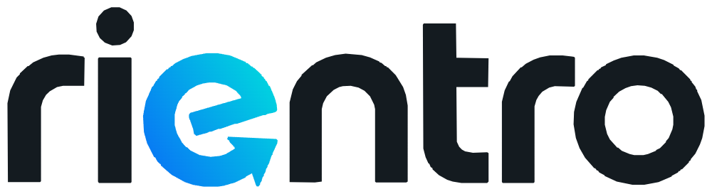

<picture><source media="(prefers-color-scheme: dark)" srcset="media/wordmark-dark.png"></picture>

<h1 align="center">Rientro</h1>

<a href="README.md">Italiano</a> · <strong>English</strong>

<strong>Arrive home. Receive a request. You decide whether to enter.</strong>

Windows · Android · Web app · Free proprietary software

Rientro connects your return to the home network with a confirmation request on
your phone. After you approve, it can coordinate the alarm, gate and smart lock
according to your settings and supported devices. Reconnecting to Wi-Fi alone
does not open anything.

> **Pre-release 2.0.1 — check compatibility with your own installation.**
> The Home Assistant arrival flow has been tested in the development household.
> New direct connectors have software tests but still require tests on real
> hardware. Start with status readings and notifications, then supervise your
> first physical commands. Real iPhone/iPad notification tests remain pending.

## What is included

- A one-time authenticated phone confirmation for authorized arrival actions.
- Gate, alarm and smart lock configuration, with configurable order and delays.
- Home Assistant or the documented compatible direct integrations.
- Minimum absence and reconnection times; phone association and administrator roles.
- Smart-device bindings, light automations, diagnostics, alerts, encrypted backups and history.
- Android app and web app. Administrators can configure the household from Windows or the app.

Rientro is free, with no subscription. Each phone pairs with its household
program using a one-time code. Device requirements still apply: light automations use Home Assistant;
socket/climate bindings do not imply universal device commands are implemented.

## At home and away

You need a Windows 10/11 x64 PC that stays powered on with Rientro running, a
supported installation and a supported presence source. Use your home network
locally. For access from outside, configure **Tailscale** on the PC and phone,
authorized access and your own HTTPS address. Tailscale has its own terms and limits.

GitHub distributes files; it does not host your home service. Reaching the
interface remotely does not itself authorize an opening: the confirmation and
presence checks required by the program still apply.

On iPhone/iPad, open your household's trusted HTTPS address in Safari and choose
**Share → Add to Home Screen**. Web notifications require a compatible device,
an installed Home Screen web app and permission. There is no native iOS app or
universal link that automatically connects every household.

## Downloads

Get the files from **[Pre-release 2.0.1](https://github.com/Mik883/Rientro/releases/tag/v2.0.1)**:

| Download | Purpose |
| --- | --- |
| [Windows setup](https://github.com/Mik883/Rientro/releases/download/v2.0.1/Rientro-Setup-2.0.1-x64.exe) | Windows 10/11 x64 installer |
| [Windows portable](https://github.com/Mik883/Rientro/releases/download/v2.0.1/Rientro-Portable-2.0.1-x64.zip) | Extract the entire archive before running |
| [Android APK](https://github.com/Mik883/Rientro/releases/download/v2.0.1/Rientro-2.0.1.apk) | Signed app, distributed directly |
| [Web interface](https://github.com/Mik883/Rientro/releases/download/v2.0.1/Rientro-Webapp-2.0.1.zip) | Requires the household backend; not a standalone server |
| [SHA-256 checksums](https://github.com/Mik883/Rientro/releases/download/v2.0.1/SHA256.txt) | Verify downloaded files |
| [Third-party licences](https://github.com/Mik883/Rientro/releases/download/v2.0.1/Rientro-Licenze-terze-parti-2.0.1.zip) | Notices, inventories and applicable source information |

Windows executables do not have an Authenticode signature. The Android APK
is release-signed. Check the official download and SHA-256 checksum.

Read the [English installation and configuration guide](docs/en/GUIDE.md),
[compatibility matrix](docs/en/COMPATIBILITY.md) and [release notes](docs/en/RELEASE-NOTES.md).
Repository documentation is bilingual; the application's interface is currently in Italian.

## Videos

Demonstration of the project in landscape and portrait formats.
Captions are currently in Italian.
[Landscape](media/rientro-presentazione.mp4) · [Portrait](media/rientro-verticale.mp4)

## Licence, support and voluntary contributions

Rientro is **free proprietary software, not open source**. Original code and
assets belong to Michele Perrino. Resale and redistribution of derivative
versions require written authorization. Third-party components retain their
own licences and rights.
[Italian licence](LICENSE.txt) · [English translation](LICENSE.en.txt) ·
[Third-party notices](docs/en/THIRD-PARTY.md)

Report reproducible problems or compatibility results through GitHub Issues in
Italian or English. Do not post credentials, pairing codes, private network data
or security vulnerabilities. Contact **mikelean@hotmail.it** privately for security issues.
No guaranteed response time or emergency support is offered.

You can voluntarily support development through [PayPal](https://www.paypal.me/perrinomichele).
A contribution does not buy features, commercial redistribution rights or guaranteed support.
