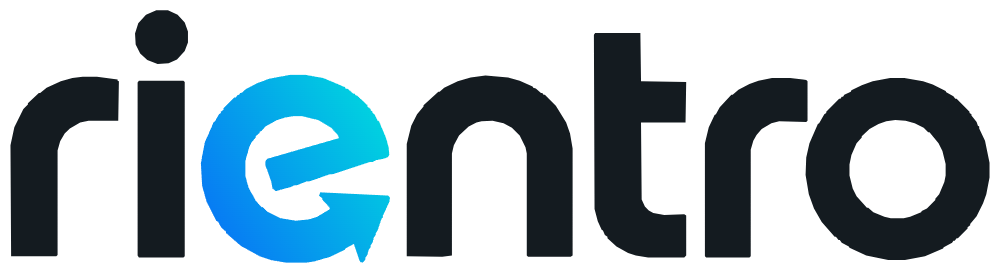

<picture><source media="(prefers-color-scheme: dark)" srcset="media/wordmark-dark.png"></picture>

<h1 align="center">Rientro</h1>

<strong>Italiano</strong> · <a href="README.en.md">English</a>

<strong>Torni a casa. Ricevi la richiesta. Decidi tu se entrare.</strong>

Windows · Android · Webapp · Gratuito con licenza proprietaria

Rientro collega il rilevamento del ritorno sulla rete domestica a una richiesta
di conferma sul telefono. Dopo l'autorizzazione può coordinare allarme, cancello
e serratura smart secondo le compatibilità e la sequenza configurate.
La sola riconnessione Wi-Fi non apre la porta o il cancello.

> **Pre-release 2.0.2 — versione iniziale da verificare sul proprio impianto.**
> Il flusso Home Assistant è stato provato nell'abitazione di sviluppo. I nuovi
> connettori diretti hanno test software ma richiedono verifica sui modelli reali.
> Consulta la matrice di compatibilità, poi prova letture e notifiche prima dei
> comandi fisici. Le prove reali iPhone/iPad rimangono da completare.

## Cosa comprende

- Conferma monouso dal telefono per le azioni di rientro autorizzate.
- Cancello, allarme e serratura smart; ordine e attese configurabili.
- Home Assistant oppure connettori diretti compatibili.
- Tempi configurabili di assenza e riconnessione; associazione e ruoli dei telefoni.
- Connettori smart, automazioni luci, diagnostica, avvisi, backup cifrato e storico.
- App Android e webapp; l'amministratore configura l'abitazione dal programma o dall'app.

Rientro è gratuito, senza abbonamento. Ogni telefono si associa al programma
della propria abitazione tramite un codice monouso.
Le funzioni smart mantengono i loro requisiti: le automazioni luci usano Home Assistant;
l'associazione di prese/clima non promette comandi non ancora implementati.

## Collegamento locale e da fuori casa

Serve un PC Windows 10/11 x64 acceso con Rientro attivo, un impianto compatibile e
una sorgente di presenza supportata. In casa si usa la rete domestica. Per l'accesso
dall'esterno configura **Tailscale** su PC e telefono e il tuo indirizzo HTTPS.
Tailscale mantiene termini e limiti propri. GitHub distribuisce i file, non ospita
il servizio domestico. Raggiungere l'interfaccia da remoto non autorizza di per sé
l'apertura: restano conferma e controlli di presenza previsti dal programma.

Per iPhone/iPad apri l'URL HTTPS della tua casa in Safari e scegli Condividi →
Aggiungi alla schermata Home. Serve HTTPS attendibile e consenso notifiche sul
dispositivo compatibile. Non esiste un link universale che abilita ogni casa.

## Download e installazione

I pacchetti sono nella **[Pre-release 2.0.2](https://github.com/Mik883/Rientro/releases/tag/v2.0.2)**.

| Download | Uso |
| --- | --- |
| [Rientro-Setup-2.0.2-x64.exe](https://github.com/Mik883/Rientro/releases/download/v2.0.2/Rientro-Setup-2.0.2-x64.exe) | Setup Windows 10/11 x64 |
| [Rientro-Portable-2.0.2-x64.zip](https://github.com/Mik883/Rientro/releases/download/v2.0.2/Rientro-Portable-2.0.2-x64.zip) | Portable Windows: estrarre completamente |
| [Rientro-2.0.2.apk](https://github.com/Mik883/Rientro/releases/download/v2.0.2/Rientro-2.0.2.apk) | App Android firmata |
| [Rientro-Webapp-2.0.2.zip](https://github.com/Mik883/Rientro/releases/download/v2.0.2/Rientro-Webapp-2.0.2.zip) | Interfaccia web: backend domestico necessario |

[Impronte SHA-256](https://github.com/Mik883/Rientro/releases/download/v2.0.2/SHA256.txt) · [Note della versione](https://github.com/Mik883/Rientro/releases/tag/v2.0.2) · [Licenze di terzi](https://github.com/Mik883/Rientro/releases/download/v2.0.2/Rientro-Licenze-terze-parti-2.0.2.zip)

[Primo avvio](docs/GUIDA-PRIMO-AVVIO.md) · [Aggiornamento](docs/AGGIORNAMENTO.md) ·
[Compatibilità](docs/COMPATIBILITA-CONNETTORI.md) · [Stato e limiti](docs/STATO-E-LIMITI.md)

La documentazione è disponibile in italiano e [inglese](README.en.md). L’interfaccia dell’app è attualmente in italiano.

## Video

Presentazione dimostrativa del progetto, nei formati orizzontale e verticale.
[Orizzontale](media/rientro-presentazione.mp4) · [Verticale](media/rientro-verticale.mp4)

## Licenza e contributi volontari

Rientro è gratuito e proprietario, **non open source**. Il codice e le risorse
originali appartengono a Michele Perrino. Rivendita e distribuzione di versioni
derivate richiedono autorizzazione scritta. Le licenze dei componenti esterni
mantengono integralmente i propri diritti e obblighi.
[Licenza Rientro](LICENZA-RIENTRO.txt) · [Componenti esterni](AVVISI-TERZE-PARTI.txt)

Puoi sostenere volontariamente lo sviluppo con [PayPal](https://www.paypal.me/perrinomichele).
Il contributo non acquista funzioni, licenze commerciali o assistenza garantita.
Segnalazioni: GitHub Issues, senza pubblicare token, codici, MAC o dati dell'impianto.
Contatto: mikelean@hotmail.it.
